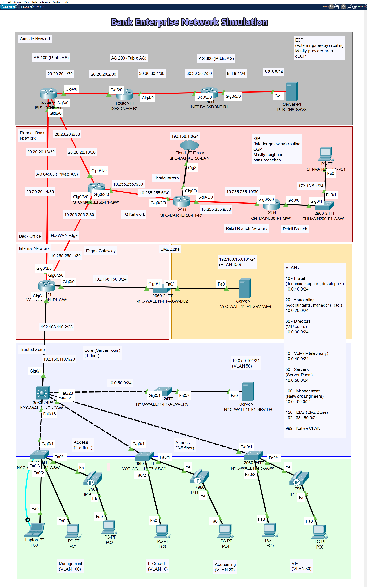

# 🏦 Enterprise Bank Network: Secure Global Infrastructure & Perimeter Defense


<p align="center">
  
</p>

## 📌 Executive Summary

This repository contains an enterprise-grade network infrastructure design and simulation built in **Cisco Packet Tracer**.

**Real-World Background:** This architecture is derived from a comprehensive infrastructure audit and hands-on implementation conducted during a network engineering internship at a commercial enterprise bank. To comply with strict Non-Disclosure Agreements (NDA), all original corporate names, public IP schemas, and physical locations have been fully abstracted.

The simulated topology centers on a New York Headquarters (NYC-WALL11) and its secure integration with regional branches (San Francisco, Chicago) across a multi-ISP global routing environment.

**Engineering Objective:** The primary goal of this project is to demonstrate advanced proficiency in enterprise network design, L2/L3 segmentation, edge security, and traffic isolation. The architecture simulates a complete, end-to-end traffic flow for a public-facing **Banking Web Service (DBO)**, validating NAT, ACLs, and routing adjacencies.

> **Simulation Scope & Target Architecture Note**
> This repository documents a comprehensive **Target Enterprise Architecture**. Due to Cisco Packet Tracer limitations (lack of L7 inspection, advanced SD-WAN, and third-party vendor appliances), the `.pkt` simulation represents a functional L2/L3 logical equivalent. Advanced features like Check Point NGFW, F5 WAF, and Nginx are theoretical production standards. Within the simulation, these boundaries are functionally emulated using robust Cisco IOS Extended ACLs, NAT boundaries, and baseline routing.

---

## 🛑 The Business Problem (As-Is Architecture)

Prior to this deployment, the audited infrastructure exhibited critical design flaws common in legacy networks:

* **Flat Network Vulnerabilities:** Public-facing services resided in the same routing domain as corporate assets (Trusted Zone).
* **Direct L7 Exposure:** External traffic terminated directly on backend application servers without an Application Layer (L7) buffer, exposing the technology stack to automated reconnaissance.
* **Topological Leaks:** Internal RFC 1918 IP addresses were exposed to the WAN edge due to a lack of proper Network Address Translation boundaries.

## 💡 The Engineered Solution (To-Be Architecture)

To mitigate these risks and enforce strict **Defense-in-Depth and network segmentation principles**, the architecture was upgraded to a **Collapsed Core** model. The new perimeter introduces a dedicated **Demilitarized Zone (DMZ)**, stateful-emulated Extended Access Control Lists (ACLs), and secure traffic buffers between the global internet and internal databases.

---

## 🛠️ Core Technology Stack (Packet Tracer Implementation)

The infrastructure implements a rigorous **Defense-in-Depth** strategy across the OSI model within the simulation constraints:

### 🌐 Layer 2 (Data Link) & Campus Switching

* **VLAN Segmentation (802.1Q):** Strict logical air-gapping of organizational units (IT, Accounting, VIPs, Server Core, DMZ).
* **Spanning Tree (Rapid-PVST+):** Sub-second loop prevention across the Layer 2 domain with edge BPDU Guard (`spanning-tree bpduguard enable`).
* **CDP (Cisco Discovery Protocol):** Dynamic Voice VLAN tagging (VLAN 40) for cascaded IP Telephony topologies.
* **L2 Hardening:** Enforced Port Security (Restrict mode, max 2 MAC addresses), DHCP Snooping, and Native VLAN (VLAN 999) blackholing to mitigate VLAN Hopping and MAC Spoofing attacks.

### 🔀 Layer 3 (Network) & Advanced Routing

* **IPv4 Schema (RFC 1918):** Advanced VLSM (Variable Length Subnet Masking) and Inter-VLAN routing via Switched Virtual Interfaces (SVIs).
* **OSPFv2 (Interior Gateway Protocol):** Single-Area OSPF (Area 0) deployed for rapid internal convergence and dynamic default-route injection (`default-information originate`).
* **eBGP (Exterior Gateway Protocol):** Edge routing establishing peering sessions between the Bank's Private Autonomous System (AS 64500) and upstream ISPs (AS 100, AS 200, AS 300).

### 🛡️ Layer 4 (Transport) & Perimeter Defense

* **NAT / PAT (Network Address Translation):**
* *NAT Overload (Dynamic PAT):* Masquerading outbound corporate traffic using `access-list 1` (10.0.0.0/16) to hide the internal topology.
* *Static PAT (Port Forwarding):* Deterministic inbound access, mapping the public Edge IP strictly to the internal DMZ proxy for both HTTP (TCP 80) and HTTPS (TCP 443).


* **Strict DMZ Isolation:** A dedicated `DMZ_OUT_FILTER` Extended ACL applied to the Gi0/0.150 subinterface, explicitly dropping any unsolicited traffic originating from the 192.168.150.0/24 subnet toward the corporate LAN (10.0.0.0/8).
* **Stateful ACL Emulation:** Utilized the `established` keyword within the `SECURE_DMZ` ACL to permit return traffic for internally initiated TCP sessions while dropping unsolicited inbound SYN floods.

### ⚙️ Infrastructure Management & Core Services

* **In-Band Management & SSHv2:** Secure, encrypted CLI management configured on the Edge Router (vty lines with `transport input ssh`) and a dedicated Management VLAN (VLAN 100) on the Core.
* **DHCP Relay:** Dynamic IP allocation with L3 switches forwarding broadcast requests (`ip helper-address 10.0.50.101`) to centralized servers from configured SVIs.

### 💻 Layer 7 (Application) & Target Architecture

* **Reverse Proxy Architecture (Target):** Nginx is positioned in the DMZ to absorb external TCP connections, terminate SSL/TLS, and completely hide backend database technologies.
* 💡 *Hybrid Simulation Note:* While the L2/L3 topology, routing, and perimeter defense are built natively in Cisco Packet Tracer, the Application Layer (Ubuntu Server, Docker, Nginx) was engineered and validated in a parallel **VirtualBox** environment to overcome Packet Tracer's L7 limitations.

---

## 📖 Primary Technical Documentation (Architecture & LLD)

The authoritative technical specifications and architectural decision rationales are maintained in the **[/docs](https://www.google.com/search?q=./docs/)** directory:

1. 📄 **[01-Topology-and-Zones.md](https://www.google.com/search?q=./docs/01-Topology-and-Zones.md)** — Physical/logical topologies, security zones (Outside, DMZ, Trusted, OOB), and core hardware inventory.
2. 📄 **[02-IPAM-and-VLANs.md](https://www.google.com/search?q=./docs/02-IPAM-and-VLANs.md)** — IP Address Management (IPAM), RFC 1918 allocations, 802.1Q VLAN matrix, and access switchport hardening.
3. 📄 **[03-Routing-QoS-and-Switching.md](https://www.google.com/search?q=./docs/03-Routing-QoS-and-Switching.md)** — Dynamic routing (OSPF Area 0, eBGP AS 64500), SD-WAN overlays, Spanning Tree tuning, strict QoS DSCP queues, and routing design rationale.
4. 📄 **[04-Security-and-Perimeter.md](https://www.google.com/search?q=./docs/04-Security-and-Perimeter.md)** — Threat modeling (Flat vs. DMZ), edge firewall placement, Static PAT vs 1:1 NAT trade-offs, L7 Reverse Proxy isolation, and Data Center microsegmentation.
5. 📄 **[05-Management-and-Observability.md](https://www.google.com/search?q=./docs/05-Management-and-Observability.md)** — Out-of-band console access (OOB), NTP Stratum design, monitoring telemetry, and configuration management automation.

---

## 🗂️ Repository Structure

```text
├── docs/                                        # Primary Technical Documentation & Architecture Specifications
│   ├── 01-Topology-and-Zones.md
│   ├── 02-IPAM-and-VLANs.md
│   ├── 03-Routing-QoS-and-Switching.md
│   ├── 04-Security-and-Perimeter.md
│   └── 05-Management-and-Observability.md
├── configs/                                     # Extracted running-configs from Cisco devices
│   ├── CHI-MAIN200-F1-ASW1_running-config.txt
│   ├── NYC-WALL11-F1-CSW1_running-config.txt    # HQ Collapsed Core L3 Switch
│   ├── NYC-WALL11-F1-GW1_running-config.txt     # HQ Edge Router (NAT, ACL, eBGP)
│   └── ... (additional configs)
├── screenshots/                                 # Proof of concept and verification tests
│   ├── PacketTracer_XXX.png
│   └── ...
├── Enterprise-Bank-Network-CPT.pkt                  # Main Cisco Packet Tracer project file
├── Enterprise-Bank-Network-Topology.jpg         # High-Resolution L2/L3 Logical Topology
└── README.md                                    # Executive summary and project overview


```

---

## 🚀 How to Run the Simulation

1. Download the `Enterprise-Bank-Network-CPT.pkt` file from this repository.
2. Open the file using **Cisco Packet Tracer v8.x** or higher.
3. Allow 30-45 seconds for Spanning Tree Protocol (STP) and OSPF adjacencies to converge.
4. **Test Data Plane Connectivity:**

* **External Access:** Open the web browser on the Outside Network PC (8.8.8.8) and navigate to `[https://20.20.20.14](https://20.20.20.14)`. *(Note: Due to Packet Tracer limitations, this will load the simulator's built-in HTTP page representing the DMZ proxy)*.
* **Internal SVI Routing:** Open the command prompt on `CHI-MAIN200-F1-PC1` and ping the Core Database (`10.0.50.101`). The traffic will successfully route through the OSPF Area 0 backbone.
* **DMZ Isolation Validation:** Open the command prompt on the `NYC-WALL11-F1-SRV-WEB` server (`192.168.150.101`) and ping the Core Database (`10.0.50.101`). The packets will return *Destination host unreachable*, proving the `DMZ_OUT_FILTER` ACL is actively blocking DMZ-to-LAN traversal.