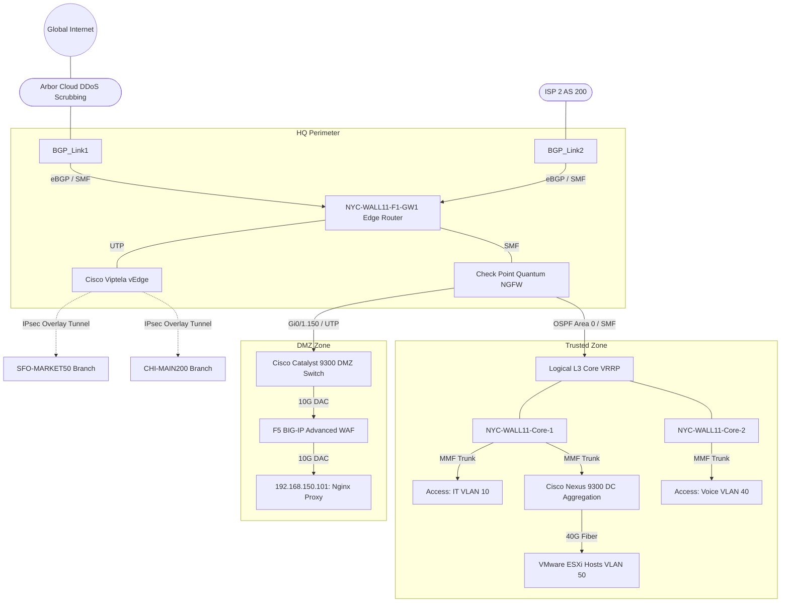

# 🗺️ 1. Topology, Network Zones & Hardware Inventory

> **Simulation Scope Note:** This document describes the actual Cisco Packet Tracer implementation alongside the intended **Target Enterprise Architecture**. Theoretical enterprise features (such as Check Point NGFW, F5 WAF, Out-of-Band networks, and dual-core VRRP) represent the production standard and are clearly marked as Target Architecture. Within the simulation itself, perimeter boundaries and segmentation are functionally emulated using Cisco IOS Extended ACLs, NAT boundaries, and single-core L3 routing.

---

## 🏗️ 1.1 Network Security Zones

To comply with strict Defense-in-Depth principles and PCI DSS segmentation requirements, the infrastructure is rigidly divided into functional zones. Inter-zone traffic is implicitly denied and requires explicit ACL policy exceptions.

1. **Outside Zone (Untrusted):**
* Comprises the global Internet and upstream Internet Service Providers (ISPs). Traffic originating here is considered highly hostile.

2. **DMZ - Demilitarized Zone (VLAN 150):**
* A semi-trusted buffer zone hosting external-facing services.
* *Constraint:* Devices in the DMZ are strictly prohibited from initiating inbound L3 connections to the Trusted Zone via the `DMZ_OUT_FILTER` ACL.

3. **Trusted Zone (Inside):**
* The highly secure corporate Local Area Network (LAN). It houses the Core Banking Data Center, employee workstations, VoIP infrastructure, and internal management jump-hosts.

4. **Out-of-Band (OOB) Zone (Target Architecture):**
* A physically isolated management network (VLAN 200). It utilizes dedicated switches and independent cellular (LTE/4G) uplinks to provide emergency console access.

---

## 📊 1.2 Logical Topology Diagram (Target Architecture)

The following Mermaid diagram illustrates the logical flow of traffic in the intended production environment, including theoretical cloud scrubbing, WAF layers, and SD-WAN. *(Note: See the included .pkt file and engineering matrix below for the simulated L2/L3 equivalent without these L7 appliances)*.

---

## 🏢 1.3 Physical Architecture & Cabling Strategy

The primary Headquarters (NYC-WALL11) leverages a **Collapsed Core** architecture. Rather than deploying a traditional Three-Tier model (Access, Distribution, Core), the Core and Distribution layers are merged into high-performance Layer 3 routing switches.

### Target High Availability (VRRP)

To ensure continuous high availability, the production target infrastructure consists of two Layer 3 switches utilizing FHRP/VRRP to form a unified logical core. *In the Packet Tracer simulation, this is scaled down to a single core switch (`NYC-WALL11-F1-CSW1`) acting as the sole default gateway for all VLANs*.

### Cabling Standards

* **External/WAN Edge:** Connections between the Edge Routers and ISP Demarcation points utilize **Single-Mode Fiber (SMF)** to eliminate modal dispersion over long distances.
* **Internal Aggregation:** Links between the Core Switches and Access/Data Center switches utilize **Multi-Mode Fiber (MMF)** to support high bandwidth requirements.
* **Rack-Level (Top of Rack):** Interconnects between DMZ servers utilize **Direct Attach Copper (DAC)** twinax cables for ultra-low latency.

---

## 🗄️ 1.4 Core Device Inventory (Packet Tracer Implementation)

The following table documents the critical infrastructure hardware actually configured and validated within the Cisco Packet Tracer simulation. Theoretical appliances (such as Check Point NGFW, F5 WAF, and Cisco Viptela) have been strictly excluded from this engineering matrix as they are not present in the configuration files.

| Hostname | Role / **What** it is | Purpose / **Why** it exists | **What** & **How** it connects |
| --- | --- | --- | --- |
| **NYC-WALL11-F1-GW1** | WAN Edge Router (Cisco 2911) | Terminates upstream ISP links. Runs eBGP for Internet routing, NAT, and stateful-emulated ACLs (`SECURE_DMZ`). | - Gi0/2/0: to ISP 1 (AS 100). 

 

 - Gi0/3/0: transit to branches. 

 

 - Gi0/1: L3 link to Core Switch. 

 

 - Gi0/0.150: 802.1Q subinterface to DMZ. |
| **NYC-WALL11-F1-CSW1** | Collapsed Core L3 Switch (Cisco 3560) | Provides wire-speed Inter-VLAN routing (SVIs) and runs internal OSPF Area 0. Acts as the default gateway. | - Gi0/1: L3 link to Edge Router. 

 

 - Fa0/1-24: 802.1Q Trunks to Access layer switches. |
| **NYC-WALL11-F1-ASW-DMZ** | DMZ Access Switch (Cisco 2960) | Provides L2 connectivity for DMZ servers (VLAN 150) and enforces Port Security. | - Gi0/1: Trunk to Edge Router. 

 

 - Fa0/1: Access port to Web Server. |
| **CHI-MAIN200-F1-GW1** | Branch Router (Cisco 2911) | Terminates transit links and routes traffic for the Chicago branch via OSPF Area 0. | - Gi0/2/0: Transit from HQ. 

 

 - Gi0/0.5: 802.1Q subinterface to Branch LAN. |
| **SFO-MARKET50-F1-R1** | Branch Router (Cisco 2911) | Terminates transit links and routes traffic for the San Francisco branch via OSPF Area 0. | - Gi0/2/0: Transit from HQ. 

 

 - Gi0/0: Interface to Branch LAN. |